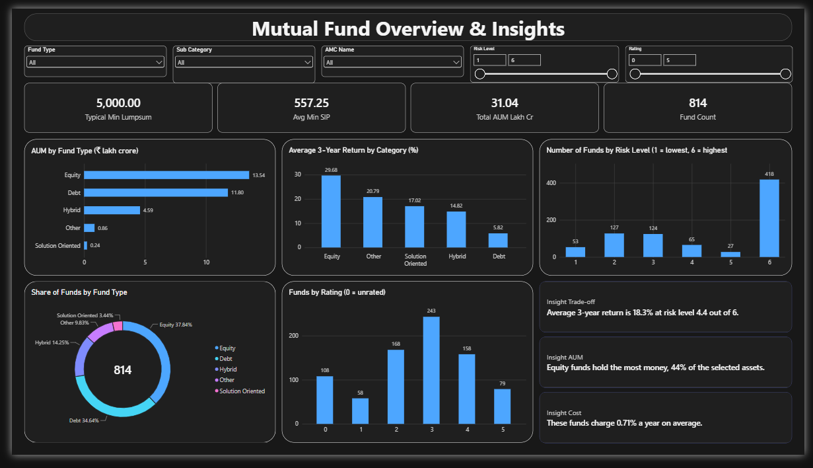
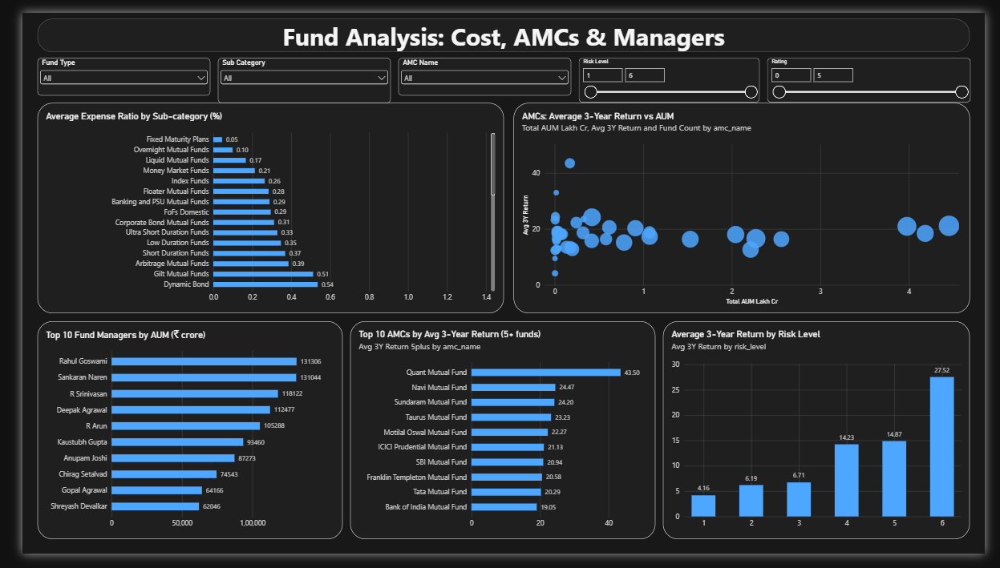

# Mutual Fund Analysis: Finding High-Return, Low-Risk Funds

An end-to-end data analytics project. It cleans a dataset of 814 mutual fund schemes, scores every fund on return, risk, cost and age, and shortlists the Top 30. The results are shown in a 3-page Power BI dashboard.

**Tools:** Python (pandas, scikit-learn), Excel, Power BI

> Educational project. Not investment advice.

## The problem

Picking the fund with the highest return can be a trap. For example, Bank of India Credit Risk Fund shows a 1-year return of 130.8%, but its 5-year return is -4.1%. A better choice needs return, risk and cost looked at together, so I built a score that does this.

## What I did

1. **Cleaned the data.** Converted text columns to numbers, handled missing values, and removed return values that could not be real.
2. **Explored the data.** Statistics, distributions and outliers.
3. **Scaled the columns** with `MinMaxScaler` so return, expense ratio and risk can be compared.
4. **Built a weighted score and ranked the funds.**
5. **Exported the Top 30 to Excel** and built a Power BI dashboard.

### Scoring formula

```
Score = 100 x ( 0.40 x 3-year return
              + 0.25 x (1 - risk)
              + 0.15 x (1 - expense ratio)
              + 0.10 x fund age score
              + 0.10 x positive 1-year return )
```

- Return, expense ratio and risk are scaled to 0-1. Expense ratio and risk are flipped (1 - value) because lower is better.
- Age score = `1 - |age - 7| / 6` (minimum 0), so 7 years is treated as "not too new, not too old". This is my own choice.
- Positive 1-year return is 1 if the 1-year return is above 0, otherwise 0.
- Risk is a fifth factor that I added, because the goal is a return-to-risk balance.

## Key findings

- **Data quality:** 14 funds from unrelated fund types had exactly the same 1, 3 and 5-year returns (for example 1.7% / 32.4% / 13.3% for 9 funds). I treated these as wrong data and removed their returns. 21 more funds are too new to have a 3-year return. That leaves **779 funds ranked**.
- **Return and risk move together.** The correlation between 3-year return and risk level is 0.81. Average 3-year return rises from 4.16% at risk level 1 to 27.52% at level 6.
- **Weights matter a lot.** With slightly more weight on return (45/15/10/10/20), only 8 of my Top 30 stay and 26 of the 30 become equity funds.
- **The Top 30:** 15 Debt, 9 Hybrid and 6 Equity funds. 22 have the lowest risk level. With these weights the safest and cheapest funds win, so most of them return only about 4 to 5%.
- **Market overview:** Equity holds the most assets (13.54 lakh crore, 43.6% of the total). Average 3-year return is 29.7% for Equity, 14.8% for Hybrid and 5.8% for Debt.

## Dashboard

The Power BI dashboard has 3 pages (Overview, Fund Analysis and Top 30 Funds) with shared filters for fund type, sub-category, AMC, risk level and rating.





## Repository structure

```
mutual-fund-analysis/
├── mutual_fund_analysis.py      # full analysis script
├── mutual_fund_analysis.ipynb   # same code as a notebook
├── requirements.txt
├── results/
│   ├── Top_30_Mutual_Funds.xlsx
│   ├── statistics_table.xlsx
│   └── plots/                   # distribution plots and box plot
├── dashboard/                   # dashboard screenshots
└── docs/Project_Writeup.docx    # project write-up
```

## How to run

1. Install Python 3.9 or newer.
2. Install the libraries:
   ```
   pip install -r requirements.txt
   ```
3. Put the dataset file `comprehensive_mutual_funds_data.csv` in the same folder as the script. The dataset is not included in this repository (see the note below).
4. Run:
   ```
   python mutual_fund_analysis.py
   ```
   It prints the results and creates the Top 30 Excel file, the statistics table, the plot pictures and a cleaned CSV for Power BI.

## Dataset

814 mutual fund schemes with 20 columns: returns (1, 3 and 5 year), expense ratio, risk level, fund age, fund size (AUM), AMC, category, sub-category, fund manager, rating, minimum SIP and lump sum, and risk statistics.

Source: **Will be ADDING SOON**

## Limitations

- Only 814 schemes. The brief for this project mentioned more than 2,500.
- 3-year returns cover one market period and do not predict the future.
- Fund age seems to stop at 10 years in the data (62% of funds show exactly 10).
- The weights and the 7-year best age are my own choices, and a different choice gives a different Top 30.


## Author

**Saish B. Bore**: https://www.linkedin.com/in/saish-bore-59068926b
